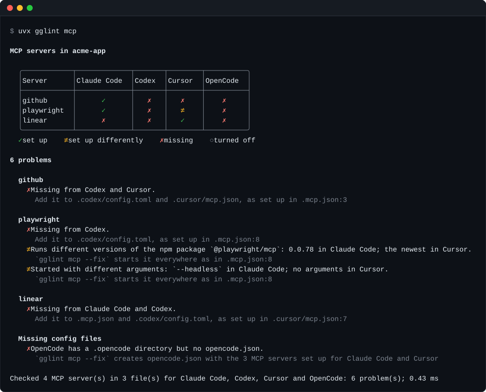

# gglint

[](https://github.com/corridor/gglint/actions/workflows/ci.yml)
[](https://pypi.org/project/gglint/)
[](https://github.com/corridor/gglint/blob/main/LICENSE)

Keep the MCP servers of every coding agent in your repository in sync.

Claude Code, Codex, Cursor and OpenCode each read MCP servers from their own config file, in
their own format. In a repository set up for more than one of them, those files drift apart:
a server is added to `.mcp.json` but not to `.cursor/mcp.json`, a version is pinned in one
file and not the other, or an agent has no MCP config at all. gglint finds every difference
and fixes it for you, written in each agent's own format.

<p align="center">
  <a href="https://raw.githubusercontent.com/corridor/gglint/main/docs/demo.svg"></a>
</p>

Click the terminal to open it on its own, then hover over a server, an agent, a cell or a
problem to see what gglint found there and what `--fix` does about it. The same details are
in this table, on hover:

<table>
<tr><th>Server</th><th><a href="#what-gglint-checks" title="Claude Code reads .mcp.json">Claude Code</a></th><th><a href="#what-gglint-checks" title="Codex reads .codex/config.toml">Codex</a></th><th><a href="#what-gglint-checks" title="Cursor reads .cursor/mcp.json">Cursor</a></th><th><a href="#what-gglint-checks" title="OpenCode has a .opencode directory but no opencode.json">OpenCode</a></th></tr>
<tr><td><a href="#what-gglint-checks" title="https://api.githubcopilot.com/mcp/, with an Authorization header"><code>github</code></a></td><td align="center"><a href="#what-gglint-checks" title="Set up in .mcp.json:3">✓</a></td><td align="center"><a href="#what-gglint-checks" title="Missing from Codex. --fix adds it to .codex/config.toml, as set up in .mcp.json:3">✗</a></td><td align="center"><a href="#what-gglint-checks" title="Missing from Cursor. --fix adds it to .cursor/mcp.json, as set up in .mcp.json:3">✗</a></td><td align="center"><a href="#what-gglint-checks" title="OpenCode has no opencode.json. --fix creates it with the 3 MCP servers set up for Claude Code and Cursor.">✗</a></td></tr>
<tr><td><a href="#what-gglint-checks" title="npx -y @playwright/mcp@0.0.78 --headless in Claude Code; npx -y @playwright/mcp@latest in Cursor"><code>playwright</code></a></td><td align="center"><a href="#what-gglint-checks" title="Set up in .mcp.json:8: npx -y @playwright/mcp@0.0.78 --headless">✓</a></td><td align="center"><a href="#what-gglint-checks" title="Missing from Codex. --fix adds it to .codex/config.toml, as set up in .mcp.json:8">✗</a></td><td align="center"><a href="#what-gglint-checks" title="Set up differently in .cursor/mcp.json:3: the newest version, without --headless. --fix starts it as in .mcp.json:8">≠</a></td><td align="center"><a href="#what-gglint-checks" title="OpenCode has no opencode.json. --fix creates it with the 3 MCP servers set up for Claude Code and Cursor.">✗</a></td></tr>
<tr><td><a href="#what-gglint-checks" title="https://mcp.linear.app/sse"><code>linear</code></a></td><td align="center"><a href="#what-gglint-checks" title="Missing from Claude Code. --fix adds it to .mcp.json, as set up in .cursor/mcp.json:7">✗</a></td><td align="center"><a href="#what-gglint-checks" title="Missing from Codex. --fix adds it to .codex/config.toml, as set up in .cursor/mcp.json:7">✗</a></td><td align="center"><a href="#what-gglint-checks" title="Set up in .cursor/mcp.json:7">✓</a></td><td align="center"><a href="#what-gglint-checks" title="OpenCode has no opencode.json. --fix creates it with the 3 MCP servers set up for Claude Code and Cursor.">✗</a></td></tr>
</table>

- **One view of every agent.** A table shows which agent gets which server, and how each
  one differs.
- **One fix.** `--fix` adds the missing servers and config files and starts each server the
  same way in every agent. It never removes a server, and keeps your comments and formatting.
- **Each agent's own format.** A server is translated between JSON and TOML, between each
  agent's syntax for environment variables, and between local and remote server types.
- **Fast and read-only by default.** gglint reads a handful of files at fixed paths and
  finishes in under a millisecond. It never starts a server or downloads anything.
- **Built for CI.** It exits with status 1 when it finds a problem, and `--format lines`
  prints one problem per line.

In November 2026 we checked the 258 most-starred GitHub repositories set up for two or more
of these agents. Of the 179 that configure MCP servers, 128 (72%) had at least one of the
problems gglint reports.

## Quick start

gglint runs with `uvx`, which comes with [uv](https://docs.astral.sh/uv/). If `uvx` isn't on
your machine, install uv with its
[installation guide](https://docs.astral.sh/uv/getting-started/installation/) first.

From the root of a repository, run these three commands in order:

```sh
uvx gglint mcp
uvx gglint mcp --fix
git diff
```

The first reports every problem, the second fixes them, and the third shows what changed.
`uvx` downloads gglint the first time and reuses it afterwards; there's nothing else to
install. It works on Linux, macOS and Windows.

## Usage

```text
uvx gglint mcp [--fix] [--source AGENT] [--format table|lines] [PATH]
uvx gglint mcp --servers [PATH]
```

| Option              | Effect                                                                                   |
| ------------------- | ---------------------------------------------------------------------------------------- |
| *(none)*            | Report every problem and draw each server in each agent.                                 |
| `--fix`             | Add missing servers and config files, start each server the same way, then report what's left. |
| `--source AGENT`    | Take each server's setup from `AGENT` where it has the server: `claude-code`, `codex`, `cursor` or `opencode`. |
| `--format lines`    | Print one line per problem instead of the table, for editors and CI.                     |
| `--servers`         | List every configured server, file by file, without comparing them.                      |
| `PATH`              | The repository's root. Defaults to the current directory.                               |

| Exit status | Meaning                                                                       |
| ----------- | ----------------------------------------------------------------------------- |
| `0`         | Every agent gets the same servers, set up the same way.                       |
| `1`         | gglint found a problem, one is left after `--fix`, or there are no MCP config files. |

Colours are used when standard output is a terminal and `NO_COLOR` isn't set. The summary
line, with counts and timing, goes to standard error.

## What gglint checks

| Rule               | Reported when                                                                                       | Fixed by          |
| ------------------ | --------------------------------------------------------------------------------------------------- | ----------------- |
| `missing-server`   | A server in one agent's config file is missing from another agent's.                                | `--fix`           |
| `missing-config`   | An agent has its own directory but no MCP config file, while other agents have servers.            | `--fix`           |
| `different-server` | The same server runs another version or has other arguments.                                        | `--fix`           |
|                    | The same server runs another program or URL, has other environment variables or headers, or is turned off in one agent. | Reported only |
| `renamed-server`   | The same server has a different name in some agents.                                                | Reported only     |

`--fix` makes the command lines match, since the same server should normally start the same
way everywhere. The other differences can be deliberate, such as each agent setting its own
environment variables, so gglint reports them and leaves them to you.

**Matching servers.** Servers are matched by name, then by what they run, so a server named
differently in one agent is still recognised as the same server. The way a package is
launched doesn't count as a difference:

- `npx -y pkg`, `npx --yes pkg@latest`, `pnpm dlx pkg`, `yarn dlx pkg`, `bunx pkg` and
  `bun x pkg` all run the npm package `pkg`.
- `uvx pkg`, `uv tool run pkg` and `pipx run pkg` all run the PyPI package `pkg`.
- `npx mcp-remote <url>` reaches the remote server at `<url>`.
- No version and `latest` both mean the newest version.
- `${KEY}` in Claude Code and `${env:KEY}` in Cursor refer to the same environment variable.

Environment variables and headers are compared by name only, since their values can be
secrets.

## Supported agents

| Agent       | MCP config file                   | Agent directory | Format                                         |
| ----------- | --------------------------------- | --------------- | ---------------------------------------------- |
| Claude Code | `.mcp.json`                       | `.claude/`      | JSON, `mcpServers`                             |
| Codex       | `.codex/config.toml`              | `.codex/`       | TOML, `[mcp_servers.<name>]`                   |
| Cursor      | `.cursor/mcp.json`                | `.cursor/`      | JSON, `mcpServers`                             |
| OpenCode    | `opencode.json`, `opencode.jsonc` | `.opencode/`    | JSON with comments, `mcp.servers` or `mcp`     |

gglint compares the agents that have an MCP config file or their own directory at the
repository's root. A `CLAUDE.md`, `.cursorrules` or `AGENTS.md` file on its own doesn't
count, because it doesn't show that the agent is set up in the repository.

## How fixing works

Every server is copied from the first config file where it's turned on, in the order
Claude Code, Codex, Cursor, OpenCode. To make one agent the source of truth instead, name it
with `--source`: `uvx gglint mcp --fix --source codex` takes each server from Codex wherever
Codex has it turned on, and from the first agent otherwise. `--fix` never removes a server.

- A missing server is added to each config file that lacks it.
- An agent with its own directory but no config file gets one, with every server that is
  turned on in the other agents.
- A server that runs another version of the same program, or the same program with other
  arguments, gets the command and arguments of that first config file. Its environment
  variables, headers, on/off state and keys only one agent has, such as Codex's `cwd`, are
  kept. Review the result with `git diff`: a difference such as a runtime chosen per agent,
  or a path that starts with Cursor's `${workspaceFolder}`, may have been deliberate.
- JSON is edited with [jsonc-parser](https://github.com/dprint/jsonc-parser) and TOML with
  [toml_edit](https://github.com/toml-rs/toml), so comments and formatting are kept.
- Running `--fix` a second time changes nothing.
- A file excluded by `.gitignore` is still updated, and marked `gitignored` in the output,
  because the change won't be committed.

References to environment variables are rewritten in each agent's syntax, in values and in
command lines:

| Agent       | Environment variable `KEY`                                                                  |
| ----------- | ------------------------------------------------------------------------------------------- |
| Claude Code | `${KEY}`                                                                                    |
| Cursor      | `${env:KEY}`                                                                                |
| OpenCode    | `{env:KEY}`                                                                                 |
| Codex       | `env_vars = ["KEY"]`, `env_http_headers`, or `bearer_token_env_var` for `Authorization: Bearer` |

Remote servers get `"type": "http"` in Claude Code, or `"sse"` for a URL ending in `/sse`.
OpenCode servers get `"type": "local"` or `"remote"`, with the command and its arguments in
one list.

A server is skipped, and listed under `Not added:`, when its setup can't be expressed in the
other agent's format: for example Claude Code's `${KEY:-default}`, Cursor's
`${workspaceFolder}`, or an environment variable inside a command line, which Codex doesn't
expand.

### Example

```console
$ uvx gglint mcp --fix
Changed 4 files:
  .mcp.json             added linear
  .codex/config.toml    added github, playwright, linear
  .cursor/mcp.json      added github; updated playwright
  opencode.json (new)   added github, playwright, linear

Review the changes with `git diff`.
```

The same `github` server, written for Codex and Cursor:

```diff
# .codex/config.toml
+[mcp_servers.github]
+url = "https://api.githubcopilot.com/mcp/"
+bearer_token_env_var = "GITHUB_TOKEN"

# .cursor/mcp.json
+    "github": {
+      "url": "https://api.githubcopilot.com/mcp/",
+      "headers": {
+        "Authorization": "Bearer ${env:GITHUB_TOKEN}"
+      }
+    }
```

Cursor's `playwright` now starts as in Claude Code:

```diff
# .cursor/mcp.json
-      "args": ["-y", "@playwright/mcp@latest"]
+      "args": ["-y", "@playwright/mcp@0.0.78", "--headless"]
```

## Output formats

`--format lines` prints one problem per line: where it is, the rule, and a description, with
the server's other locations indented below it.

```console
$ uvx gglint mcp --format lines
./.mcp.json:3:5  missing-server   `github` is set up for Claude Code but not for Codex (.codex/config.toml) or Cursor (.cursor/mcp.json)
./.mcp.json:8:5  different-server `playwright` runs different versions of the npm package `@playwright/mcp`: 0.0.78 in Claude Code; the newest in Cursor
    also at ./.cursor/mcp.json:3:5
./.mcp.json:3:5  missing-config   OpenCode has a .opencode directory but no opencode.json, so it gets none of the 3 MCP servers set up for Claude Code and Cursor
```

`--servers` lists every server as it's written. Environment variables and headers are shown
by name, never by value.

```console
$ uvx gglint mcp --servers
./.mcp.json:3:5  claude-code  github  https://api.githubcopilot.com/mcp/  (headers=[Authorization])
./.mcp.json:8:5  claude-code  playwright  npx -y @playwright/mcp@0.0.78 --headless
./.cursor/mcp.json:3:5  cursor       playwright  npx -y @playwright/mcp@latest
./.cursor/mcp.json:7:5  cursor       linear  https://mcp.linear.app/sse
```

## Continuous integration

Fail a pull request when the agents' MCP servers drift apart:

```yaml
# .github/workflows/mcp.yml
name: MCP servers
on: [pull_request]

jobs:
  gglint:
    runs-on: ubuntu-latest
    steps:
      - uses: actions/checkout@v4
      - uses: astral-sh/setup-uv@v7
      - run: uvx gglint@0.2.0 mcp --format lines
```

## Security

- **Read-only by default.** Without `--fix`, gglint reads files and writes nothing.
- **Nothing is executed or fetched.** MCP servers aren't started, packages aren't resolved,
  and environment variables aren't expanded. It's safe to run on an untrusted repository.
- **Secrets stay out of the output.** Environment variables and headers are printed by name
  only.
- **One external program.** During `--fix`, gglint runs `git check-ignore` to mark files your
  `.gitignore` excludes.

## Limitations

- Servers added by Claude Code plugins, enabled in `.claude/settings.json`, aren't read. A
  server provided by a plugin can be reported as missing from Claude Code.
- User-level settings such as `~/.claude.json` or `~/.codex/config.toml` aren't read.
- Only config files at the repository's root are read, so each package of a monorepo is
  checked separately.
- VS Code and GitHub Copilot (`.vscode/mcp.json`) and Gemini CLI (`.gemini/settings.json`)
  aren't supported yet.
- Codex only reads `.codex/config.toml` in projects you have marked as trusted.

## Development

gglint is written in Rust. With a [Rust toolchain](https://rustup.rs) 1.88 or later, run these
three commands in order before each commit; CI runs the same checks:

```sh
cargo fmt
cargo clippy --all-targets -- --deny warnings
cargo test
```

`tests/corpus.rs` runs `--fix` against a directory of real repositories and checks that no
server is removed, that no environment variable, header or on/off state changes, that a
config file is created only in an agent's own directory, that no file becomes unreadable,
that problems never increase, and that a second run changes nothing:

```sh
GGLINT_CORPUS=path/to/clones cargo test --release --test corpus -- --ignored --nocapture
```

The code lives in [`src/harness/`](https://github.com/corridor/gglint/tree/main/src/harness):
`mcp.rs` reads each agent's config, `compare.rs` finds the problems, and `fix.rs` writes the
fixes.

### Releasing

1. Update `version` in `Cargo.toml` and add the release to `CHANGELOG.md`.
2. Merge to `main`.
3. Publish a GitHub release tagged `v<version>`, for example `v0.2.0`.

The [release workflow](https://github.com/corridor/gglint/blob/main/.github/workflows/pypi_release.yml)
builds and tests every wheel, publishes them to PyPI, and attaches them to the release.

## License

gglint is licensed under the [Apache License 2.0](https://github.com/corridor/gglint/blob/main/LICENSE).
The licenses of the libraries compiled into it are listed in
[THIRD_PARTY_LICENSES](https://github.com/corridor/gglint/blob/main/THIRD_PARTY_LICENSES).
